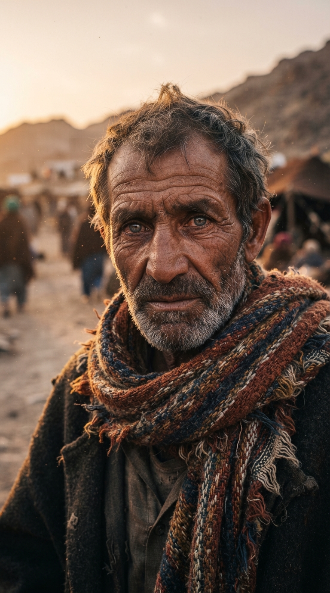

### 1. Nomadic traveler wearing an intricate woven scarf

Prompt: A close-up cinematic portrait of a nomadic traveler with deep, expressive eyes and weathered skin, wearing an intricate woven scarf. Shot on a 135mm lens, f/1.8 aperture, with a shallow depth of field. Soft, warm golden hour side-lighting highlighting the dust particles in the air. Moody, highly detailed skin textures, photorealistic, 8k resolution, cinematic film grain.

### 2. Bioluminescent forest with a winding stream at night

Prompt: An enchanting bioluminescent forest at night, featuring towering ancient trees with glowing blue and violet moss. A crystal-clear winding stream reflects the neon canopy above. Tiny, floating sparks of light drift through the air like fireflies. Surreal digital painting style, magical atmosphere, rich vibrant color palette, intricate details, masterpiece.

### 3. Model posing in a structured metallic silver gown

Prompt: Avant-garde editorial fashion photography. A model posing in a structured metallic silver gown that catches sharp reflections. Clean, minimalist studio background with dramatic high-contrast chiaroscuro lighting and crisp shadows. Shot on medium format camera, sleek and polished aesthetic, cold color grading with a splash of neon amber.

### 4. Steaming mug of hot cocoa on a rainy windowsill

Prompt: A macro photograph of a steaming ceramic mug of hot cocoa sitting on a wooden windowsill. Raindrops are sliding down the glass pane outside, blurring the soft lights of a distant city in the background. A cozy, knitted wool blanket is draped nearby. Soft, diffused indoor lighting, warm amber tones, ultra-detailed steam swirls, nostalgic mood.
